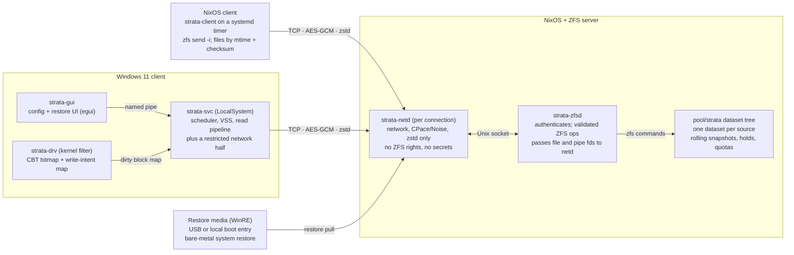

<!--
  DO NOT EDIT THIS FILE.
  This plan is owned by the Overseer and may be modified ONLY by the Overseer.
  Agents must never edit, reformat, move, rename or delete it, not even to fix a typo.
  If something here is unclear or must change, ask the user to pass your question to the Overseer.
-->

# Strata — Architecture Plan

Nov 17, 2026 · Peter Flynn

## Summary

Strata is a block-level backup system written in Rust. Clients push only changed blocks (or ZFS send streams) over zstd-compressed, AES-256-GCM-encrypted TCP to a NixOS/ZFS server. The server keeps each source in its own dataset with a rolling set of snapshots. Each client talks to exactly one server; off-site copies are the server's job, made by replicating its dataset tree with any ZFS replication tool. Every block source is stored as a raw sparse image, so backups stay readable with standard tools (losetup, ntfs-3g, qemu-img) even without Strata. "Strata" is a working name.

| Decision | Choice |
| --- | --- |
| Language | Rust everywhere, including the Windows kernel driver |
| Windows change tracking | Kernel volume filter driver (CBT) with a crash-safe write-intent map |
| Linux file sources | mtime and ctime decide; a changed file gets a full checksum resync; filesystems without reliable timestamps are refused |
| Driver signing, Secure Boot | Required, but not handled by an agent |
| Server block storage | Sparse files, one dataset per source; not zvols, which write markedly slower |
| BitLocker | Not supported; protected volumes are refused at setup |
| Removable drives | Out of scope; anything on a USB or SD-card drive is refused at setup on both clients, judged by bus type, because internal SATA ports with hot-plug enabled also report as hot-pluggable |
| System-drive restore | Booted from WinRE/WinPE media onto plain GPT; mirrors are rebuilt in Windows afterward |
| Spanned / striped volumes | Data volumes only; restore goes into a volume you pre-build |
| Direction | Clients always connect; the server never initiates. Restores are client pulls. |
| Transport | Plain TCP, never SSH; per-client password via CPace, then AES-256-GCM, or plaintext for clients marked `insecure` and pinned to their addresses |
| Privilege split | Server and clients alike: the half that touches the network holds no storage rights, and vice versa. On the server each connection gets its own process, which learns its client's identity only from zfsd |
| Minimum OpenZFS | 2.4.4 on the server, which fixes CVE-2026-79619 |

## Threat model

Strata defends against four adversaries, and deliberately not against two others.

| Adversary | What it can do | What stops it going further |
| --- | --- | --- |
| Network attacker | Read and tamper with traffic | CPace + AES-256-GCM; a captured handshake can't be brute-forced offline. Clients marked insecure have nothing but address pinning |
| Compromised client | Push garbage into its own backups, or attack the server code that parses its traffic | That code runs in netd with no ZFS rights, holding only what this client could reach anyway; daily anchors survive a flood; its quota caps the damage |
| Malformed or hostile stream | Reach parsers on the server | Per-connection processes, userspace validation before `zfs receive`, fuzzed Rust parsers |
| Compromised server | Send hostile replies and restores | Client network halves hold no storage rights, and ZFS restore streams are validated before the client's zfs receive sees them |
| Root on the server (out of scope) | Everything in the tree | Off-site copies and optional encryption at rest limit the damage |
| Admin on a client (out of scope) | Disable or tamper with Strata | Nothing: a machine's backups are only as trustworthy as its admin |

## Components & repo layout

One Cargo workspace and one Nix flake. The flake builds and tests everything that runs on Linux and type-checks the Windows crates; the Windows binaries themselves are built on a Windows runner with the WDK.



| Crate | Runs on | Role |
| --- | --- | --- |
| `strata-proto` | all | Framing, messages, CPace + Noise handshake, zstd |
| `strata-zstream` | server, Linux client | ZFS send-stream validator: checks every stream before `zfs receive` sees it, on the server for backups and on the Linux client for restores |
| `strata-blockio` | all | Extent pipeline: aligned I/O, XXH3-128 block hashing, zero detection, checksum resync |
| `strata-netd` | server | Network daemon, one process per connection; holds no ZFS rights and no secrets |
| `strata-zfsd` | server | ZFS helper: small local API, runs every `zfs` call, authenticates clients, passes client-scoped fds to netd. Ships with `strata-init`, `strata-mountd` and the `strata-server` admin CLI |
| `strata-client` | NixOS | Backup, list and restore CLI: a ZFS half, a network half and a small root helper that opens files and devices |
| `strata-drv` | Windows kernel | CBT volume filter (KMDF via windows-drivers-rs) |
| `strata-svc` | Windows | Service: scheduler, VSS requestor, volume I/O, plus a restricted network half |
| `strata-gui` | Windows | Config and restore UI (egui); no privileges of its own |
| `strata-restore` | WinRE / WinPE | Bare-metal restore UI (strata-gui's screens, drawn in software); shares its disk code with `strata-svc` |

Flake outputs: `nixosModules.server`, `nixosModules.client`, `packages.*` for the Linux binaries, and `checks.*` (NixOS VM tests against real ZFS). Windows userspace crates type-check on Linux (`cargo check --target x86_64-pc-windows-gnu`), so most Windows code gets compiler feedback without a Windows host. Windows ships as one MSI (driver, service, GUI, restore tool). The parsers in `strata-proto` and `strata-zstream` are fuzzed with cargo-fuzz.

`VERIFY.md` lists everything the dev sandbox can't test (real ZFS, the restore media, the driver, VSS, the GUIs), each with exact commands and expected results. It lives in the repo root on `staging`. Implementation agents create it in milestone 1 and keep it current: whoever builds or changes something the sandbox can't test adds or updates its entry in the same commit, saying what the entry checks, why the sandbox can't, the exact commands and the expected results. The verification agent runs the entries in the VM and records each result in its entry (commit, date, pass or fail, and the output of any failure). It may fix a command that is plainly broken, noting the fix in the entry, but a change to what an entry verifies goes through the Overseer. The Overseer may edit any of it. Keep it short. An entry exists only for behavior the sandbox genuinely can't exercise; anything a unit test, the fake ZFS or `nix flake check` can cover becomes a test instead. Related checks share one entry (one per feature, not per function). An entry holds a heading, one line on what and why, the commands, the expected results, and the latest result only: a new run replaces the old one, since git keeps the history, and failure output is trimmed to the lines that show the failure. An entry is deleted as soon as its behavior becomes testable in the sandbox or leaves the code. The verification VM is QEMU/KVM under libvirt with OVMF, swtpm and an emulated NVMe disk. The repo's `vmctl` drives it at the virtual-hardware level (QMP screenshots the agent reads as images, plus keyboard and absolute-pointer input), which reaches the screens no in-guest tool can: firmware setup, UAC prompts, WinRE, bugchecks. `strata-gui` and `strata-restore` expose AccessKit, so tests find controls by name through UI Automation, run by a helper in the logged-in desktop session because an SSH session can't see the desktop; pixels are the fallback where UI Automation isn't available.

## Wire protocol

After a short cleartext hello, every byte is zstd-compressed and, unless the client is marked insecure, AES-256-GCM-encrypted. Each session is one TCP connection: batches compress and decompress in parallel, and a single AES-GCM stream with AES-NI already outruns a 10 GbE link, so extra connections would add complexity without adding speed.

- **Hello (cleartext):** protocol version, client name, auth mode. It doubles as the Noise prologue, so tampering breaks the handshake. The server enforces each client's configured auth mode and the client enforces its own, so neither side can be talked down to none. The server speaks the current and previous protocol version, so server and clients upgrade independently.
- **Auth `psk` (default):** CPace over Argon2id(password, salt = server id + client name), then `Noise_NNpsk0_25519_AESGCM_SHA256` keyed with the CPace output. The server never stores the password: its config holds only the Argon2id output (strata-server derive-key \<client> prints it), as does the Windows client, and a Linux client takes either a password file or that key, so a leaked server config doesn't expose passwords reused elsewhere (it is still enough to impersonate that client). CPace is the CFRG's pick among balanced PAKEs ([draft-irtf-cfrg-cpace](https://datatracker.ietf.org/doc/draft-irtf-cfrg-cpace/)); SPAKE2 ([RFC 9382](https://rfc-editor.org/rfc/rfc9382)) was not selected and is only the fallback if the draft shifts. A captured handshake can't be brute-forced offline, and each online guess costs a full connection. AES-GCM runs through snow's `ring` resolver (AES-NI/VAES). The server id in the salt is a random value, sent in the hello reply and kept in a small metadata file in the service's own \<pool>/strata/\_server dataset, so it moves with the pool and a reinstalled server keeps every client's key valid. zfsd backs off exponentially on failed handshakes per client name and per source address, and the socket unit caps MaxConnections and MaxConnectionsPerSource, so online guessing stays slow and a connection flood can't fork-bomb the host.
- **Auth `none`:** only for clients the server config marks `insecure = true`, and only from the addresses in that client's `allowFrom`, which is then required: without a password, anyone who can reach the port could otherwise read and overwrite that client's backups.
- **Framing:** length-prefixed frames of at most 64 KiB (the Noise limit); control messages are serialized with postcard (serde).
- **Compression:** zstd per \~1 MiB batch, multithreaded on the client. The level adapts: it climbs toward 9 while the network is the bottleneck and drops toward 1 when the CPU is. A batch that saves under 3% is sent raw, and compression then pauses for 64 batches before probing again, so already-compressed data costs almost no CPU.
- **Transport tuning:** Both ends rely on kernel buffer autotuning, and the server module can opt into BBR with the fq qdisc for WAN clients (off by default, since it changes host-wide settings).

| Message | Direction | Purpose |
| --- | --- | --- |
| `ListSources` / `ListSnapshots` | C→S | Browse what the server holds for this client |
| `BeginBackup{source, kind, geometry, base_gen}` | C→S | Open a session; server replies `Ready{server_gen, resume}` or `Busy{retry_after}` |
| `ZfsChunk` | both | Raw `zfs send` bytes (dataset and zvol sources, backups and restores) |
| `Extent{offset, data, hashes}` / `Discard{offset, len}` | both | Changed or freed blocks (block sources, backups and restores), each with its XXH3-128: computed by the client as it read the block, replayed from the manifest on restore |
| `Checkpoint` | C→S | Server acks only once everything before it is durable |
| `Commit{gen, meta}` | C→S | Server snapshots, replies `Committed{snapshot}` |
| `HashRange` | C→S | Hashes of a range, per 1 MiB group or per block, answered from the server's hash manifest without reading data |
| `BeginRestore{source, snapshot, full or delta(from)}` | C→S | Server streams `Extent`/`Discard` or `ZfsChunk` back |
| `Rebase{source, snapshot}` | C→S | After a restore: "my state is now this snapshot"; the server rebases before the next backup |
| `Abort` / `Error` | both | End a session |

**Generations:** each commit increments a per-source generation. The client keeps the change set for generation N+1 until `Committed` arrives. On reconnect, if the server is one ahead the commit landed and the change set is dropped. If they match, the change set is merged with newer changes and resent. Dataset sources reconcile by snapshot GUID instead of a counter.

**Resume:** dataset sources use `zfs receive -s` resume tokens. Block sources resume from the last acked checkpoint. The client resends the unsent part of the old change set plus everything changed since, read from a fresh snapshot, and the result still matches that snapshot exactly. An interrupted checksum resync simply reruns; the groups it already sent now match.

## Server

Two sandboxed daemons split the work, plus two small root helpers for setup and mounting. `strata-netd` faces the network with no ZFS rights; `strata-zfsd` runs a fixed, validated set of ZFS operations under `<pool>/strata` and never touches the network. Block sources are sparse image files in per-source datasets rather than zvols: files write markedly faster ([benchmark](https://forum.proxmox.com/threads/performance-zvol-vs-raw-files-on-a-dataset.146354/latest)) and need no device nodes. Strata never touches the pool outside \<pool>/strata: no pool properties, no vdevs, no other datasets.

1. **`strata-init`** (oneshot, root, on activation): creates the dataset tree (including \_server and, on first run, its server-id file), an overall quota on \<pool>/strata and per-client quotas, sets the inherited properties (atime, exec/setuid/devices, logbias, volmode=none), and delegates `create,destroy,mount,receive,send,snapshot,rollback,clone,hold,release,userprop,readonly,recordsize,compression,checksum,dedup,direct` to the zfsd user with `zfs allow` (`send` serves dataset restores).
2. **`strata-mountd`** (socket-activated, root): Linux can't delegate mounting to non-root users ([zfs-allow](<https://man.cx/ZFS-ALLOW(8)>)). zfsd reaches it through a Unix socket only strata-zfs can open, with no D-Bus or polkit in the path. The unit validates the dataset name, runs `zfs mount`, and hands the dataset's root directory to `strata-zfs` with mode 0700. It also mounts and unmounts the read-only clones used for restores. Existing datasets are mounted at boot by `zfs-mount.service`.
3. **`strata-zfsd`** (user `strata-zfs`): Unix-socket API only (create source, begin/checkpoint/commit/abort, hash queries, restore, rebase, prune, set properties). It also holds the per-client secrets and runs the server side of CPace, so the identity behind every request comes from zfsd's own authentication, never from netd's word. It checks every name against `<pool>/strata/<client>/<source>` and `[a-z0-9][a-z0-9_-]*` (no leading underscore, so no client can collide with \_server) and allows one session per source at a time. Hot-path operations (snapshot, hold, release, send, destroy) go through libzfs\_core. Receive runs as the `zfs receive` command (see Dataset session), which handles resume tokens, `-o` and `origin=` itself. The rest use the zfs CLI in -Hp machine-readable mode. It opens image files and `zfs receive` pipes itself and hands the fds to netd (`SCM_RIGHTS`).
4. **`strata-netd`** (`DynamicUser`): one process per connection (socket-activated, Accept=yes) handling TCP, Noise and zstd. It relays the CPace exchange to zfsd without seeing any secret; only once zfsd has authenticated the client does it receive the session keys and a channel scoped to that one client's datasets. The split is aimed at ransomware on a client: it holds that client's password, but the protocol can't delete anything, so wiping backups needs a server bug. All the heavy parsing (Noise, the C zstd library, framing) happens here, where such a bug reaches only what that client could reach anyway; going further needs a second bug in zfsd's handful of fixed-size messages. It has no `/dev` access and no delegation, and writes only through the fds it is handed.

**systemd hardening (both daemons):** `ProtectSystem=strict`, `ProtectHome`, `PrivateTmp`, `NoNewPrivileges`, empty `CapabilityBoundingSet`, `SystemCallFilter=@system-service`, `MemoryDenyWriteExecute`, `ProtectKernel*`, and `RestrictNamespaces=yes`. The last one matters: [CVE-2026-79619](https://app.opencve.io/cve/CVE-2026-79619) let any process that could open `/dev/zfs` and create a user namespace run pool-level operations. netd gets `PrivateDevices` and `RestrictAddressFamilies=AF_INET AF_INET6 AF_UNIX`. zfsd gets `DeviceAllow=/dev/zfs`, `AF_UNIX` only, and write access to `/var/lib/strata/blk` only. User-namespace delegation (`zfs zone`) was considered and rejected, because it needs exactly the userns + `/dev/zfs` combination that CVE abused.

**Read-only and isolation:**

- Received filesystems stay `readonly=on` and are never mounted: they live under a parent with `mountpoint=none`. Received zvols inherit `volmode=none`, so the server never creates device nodes for them and udev never probes client data; `zfs send` reads them without one.
- Image files are owned by `strata-zfs` and kept at mode 0400 between sessions; only an open session makes them writable. Committed snapshots are immutable regardless.
- Block-source datasets mount with `exec=off`, `setuid=off`, `devices=off`, and image files are never loop-mounted or parsed by the host.
- On startup, zfsd rolls back any block source left mid-session without a resumable session.

```
<pool>/strata                                     canmount=off, exec/setuid/devices=off, volmode=none
<pool>/strata/_server                             mountpoint=/var/lib/strata/server; server-id file
<pool>/strata/<client>                            quota from config
<pool>/strata/<client>/ds                         mountpoint=none
<pool>/strata/<client>/ds/<source>                received filesystem, never mounted
<pool>/strata/<client>/blk                        mountpoint=/var/lib/strata/blk/<client>
<pool>/strata/<client>/blk/<source>               files: data, hashes
<pool>/strata/<client>/blk/<disk-source>/<partN>  files: data, hashes
```

| Property | Received filesystem | Block-source dataset | Why |
| --- | --- | --- | --- |
| `compression` | The source's own (streams are sent with `-c`); zstd-3 if the source opts into recompression | zstd-3, with early abort on incompressible blocks | `-c` passes compressed blocks through untouched, saving CPU on both ends |
| `checksum` | blake3 | blake3 | Fast, cryptographic strength, valid for dedup |
| `dedup` | off (opt-in) | off; opt-in per source, e.g. Windows system volumes | DDT memory cost; see Risks |
| `recordsize` | From the stream (`send -L`) | max(cluster size, 16K), up to 128K (4K clusters → 16K, 64K → 64K; Linux files and devices → 64K), set before the image is first written; overridable per source (e.g. 64K for big-file volumes, trading a little over-send for less metadata) | CBT granularity matches, so every write is a whole record: no read-modify-write, and eligible for Direct I/O |
| `direct` | default | standard; `data` also gets an fd opened with `O_DIRECT` | Record-aligned writes bypass the ARC ([Klara](https://klarasystems.com/articles/managing-cache-and-direct-io-for-databases-on-zfs/)); `hashes` stays buffered |
| `sync` / `logbias` | default | standard / throughput | Durability comes from an explicit fsync at each checkpoint |
| `primarycache` | all (default) | all (default) | Metadata-only caching would defeat prefetch, so restores and sends would read synchronously, and would push every small hashes-file update into a read-modify-write from disk. Bulk writes already bypass the ARC through Direct I/O |
| `atime` | off | off | Restore reads cause no metadata writes |
| `encryption` | optional, inherited from `<pool>/strata` | same | Dedup still works within one encryption root |

**Block session:** zfsd makes the source's files writable and opens them. netd `pwrite`s whole-record extents into `data` (runs of 256 KiB or more through an O\_DIRECT fd; small scattered extents buffered, so txgs can aggregate them), punches holes for discards (`fallocate(PUNCH_HOLE)`), checks every block against the XXH3-128 the client sent, then writes that hash into `hashes`. At a checkpoint the server fsyncs both files, then acks. A hash mismatch aborts the session, because it means data was corrupted somewhere between the client's read and the server's write. On commit: fsync, then `zfs snapshot` (`-r` for disk sources) carrying user properties (`strata:gen`, `strata:time`, `strata:source`), then the files go back to 0400, then prune. A disk source's layout record is a small file in its parent dataset, because ZFS user properties cap at 8 KiB, too small for a full GPT. Data, manifest, layout and every partition land in one atomic snapshot.

**Hash manifest:** `hashes` holds each block's 16-byte XXH3-128 as computed on the client, which makes it an end-to-end check, about 1 GiB per TB at 16K blocks. XXH3 is several times faster than BLAKE3 ([comparison](https://mojoauth.com/security-guides/xxhash-vs-blake3)), and a manifest only ever compares a client's data with its own backup, so collision resistance against an attacker buys nothing. Resyncs, restore verification and rebases all compare manifests, so the server never re-reads data to answer them. Comparisons with a client go in two steps: hashes of 1 MiB groups first (an XXH3-128 over the group's block hashes, computed from the manifest on the fly), then block hashes only inside groups that differ, so checking an unchanged terabyte moves about 16 MiB of hashes instead of 1 GiB.

**Checksum resync:** the only path that reads data nothing has marked as changed, so it runs only where no change source exists. Each such case is named where it applies; there is no blanket "rescan when in doubt". It is one forward pass: 8 MiB unbuffered reads in LBA order, a few in flight, reading straight through gaps under 8 MiB instead of seeking. Each MiB is hashed as it lands and compared with the server's 1 MiB group hashes, which stream in ahead of the read cursor so the network never stalls the disk. A group that differs stays in memory until its block hashes arrive and only its differing blocks are sent, so nothing is read twice. A source's first backup uses the same pass without the comparison.

**Dataset session:** zfsd spawns `zfs receive -s -u -o readonly=on` and hands its stdin to netd. Every record passes `strata-zstream`'s validator before netd forwards it: the `DRR_BEGIN` header must carry the expected `fromguid`, record types are whitelisted (no replication `-R` streams, no properties, no corrective/heal records), and lengths are bounded. The running stream checksum is checked at the end; `zfs receive` is atomic, so a stream that fails there leaves nothing behind. The kernel's receive path had a heap overflow as recently as [CVE-2026-49430](https://cvedb.shodan.io/dashboard/cve/CVE-2026-49430), so it only ever sees records that already parsed cleanly. Client zvols arrive this way too: receive writes through the DMU, not the zvol block device, so the zvol I/O overhead that ruled zvols out for block sources doesn't apply.

**Retention:** per source, the `keep` newest snapshots (default 30) plus `dailies` (default 14): the newest snapshot of each of the last 14 days, whatever `keep` says. Both are server-authoritative. A compromised client can push 30 garbage backups in an hour and roll the `keep` window over ([the failure mode](https://www.vinchin.com/vm-backup/how-to-protect-vms-against-ransomware-without-stopping-backups.html)), but it can't touch the daily anchors from earlier days, and the total stays bounded at `keep + dailies`. The newest snapshot always carries a `zfs hold strata-base`, so the incremental base can never be pruned, and a snapshot that is a clone origin is skipped. Names follow `strata-<UTC yyyymmddThhmmssZ>-g<gen>`.

**Staleness:** a server timer flags any source whose newest snapshot is older than twice its reported interval, in the journal and in `strata-server status`.

**Concurrency:** the server runs at most `maxSessions` sessions at once (default 4). Others get `Busy{retry_after}` and back off with jitter, so a fleet that fires on the hour doesn't thrash the pool.

**Reading snapshots:** zfsd never relies on `.zfs/snapshot` automounts, which are fragile inside a sandboxed mount namespace. Restores and rebases read S through a short-lived clone that `strata-mountd` mounts read-only, and the clone also pins S until the read finishes.

**Rebase after a restore to an older snapshot S:** for block sources, zfsd diffs S's manifest against the head's and copies just those blocks from S's clone into the head; incrementals then continue. It copies rather than block-clones: cloning caused data loss in 2.2.0 and was still getting corruption fixes in 2.4.2 ([heise](https://heise.de/-11138501), [igor'sLAB](https://www.igorslab.de/en/openzfs-2-4-2-kernel-7-0-support-large-data-pools/)). For dataset sources, the next stream is received as a clone of S (`zfs receive -o origin=`). History is never destroyed.

```nix
services.strata.server = {
  enable = true;
  pool = "tank";
  listen = "0.0.0.0:7420";
  maxSessions = 4;
  defaults = { keep = 30; dailies = 14; };
  clients.workstation = {
    keyFile = "/run/secrets/strata-workstation";  # from: strata-server derive-key workstation
    quota = "4T";
    keep = 60;
  };
};
```

## Linux client

Datasets and zvols get their change set from ZFS and are never rescanned. Files and other block devices can live on any filesystem, ZFS or not, and are handled as below. Sources on USB or SD-card drives are out of scope and refused when added. Each source runs as a templated oneshot unit on its own systemd timer.

| Source | How changes are found | Stored on server as |
| --- | --- | --- |
| ZFS dataset | `zfs snapshot` → `zfs send -L -e -c -i #strata_<source>_G_<guid>` → once the server commits, bookmark the new snapshot and destroy it locally (it stays until then, because resuming an interrupted send needs it) | Received filesystem |
| zvol (`/dev/zvol/…`) | Same as a dataset | Received zvol |
| File on any filesystem (e.g. a VM image) | Each run compares the file's mtime, ctime, size, inode and device with the last run. If all match, nothing is read; if any differ, the whole file gets a checksum resync. ctime is the cross-check: nothing in userspace can set it, so a tool that rewrites a file and restores its mtime (`cp -p`, `rsync -t`, `tar -x`) is still caught. A file modified within one timestamp tick before the read is checked again next run, so a write landing in that same tick can't hide. The root helper opens the file read-only and passes the descriptor over: from a snapshot of its dataset when it lives on ZFS (mounted read-only by the helper itself, never through .zfs/snapshot), otherwise in place, with the stat repeated after the read and the run retried if anything changed meanwhile. Filesystems without reliable nanosecond mtime and ctime (FAT, exFAT, network and FUSE filesystems) are refused as unsupported when the source is added. | Block source (`data` + `hashes`) |
| Block device not on ZFS (e.g. the ESP) | Checksum resync every run, since nothing tracks its changes; the client warns when a device is larger than a few GiB. The root helper remounts the filesystem read-only for the duration (unmounted devices are read directly); if the remount fails because files are open for writing, the run retries later | Block source |

- The incremental base is a cursor bookmark named after the source and its snapshot's GUID, modelled on zrepl's replication cursor, so two sources on one dataset never share or clobber a cursor. The new cursor is created before the old one is destroyed, so a crash never leaves the client without a base, and the client pins no snapshots (or space) between runs.
- **Existing snapshots instead of new ones:** for systems that already run sanoid, zfs-auto-snapshot or similar, a ZFS-backed source can set `createSnapshots = false` and a `snapshotPattern` (e.g. `autosnap_*_hourly`). Each run then sends the newest matching snapshot instead of taking its own. It holds that snapshot for the duration so a pruning tool can't destroy it mid-send, never destroys it itself, and still advances its own cursor bookmark. A run that finds no new matching snapshot does nothing.
- A changed file is read in full, so a big VM image that changes every run belongs in a zvol or a dataset of its own, which ZFS sends incrementally. A file that never stops changing (a running VM's disk outside ZFS) can't be read consistently in place: its runs retry, and the source eventually raises a staleness alert.
- Natively encrypted source datasets can use raw send (`-w`): they stay encrypted on the server under the client's key, so the stream can't be compressed further and their blocks can't dedup against other sources.
- **Same split as the server.** The ZFS half runs as user `strata` with `zfs allow snapshot,send,bookmark,hold,release,destroy,mount` on its source datasets (zfs-allow(8) requires `mount` alongside `snapshot` and `destroy`; it can't actually mount anything, since Linux doesn't let non-root users mount) and has no network access. File and non-ZFS device sources are opened by the small root helper, which passes a read-only fd over. The network half runs as a `DynamicUser` with no ZFS rights and receives the send pipe as an fd, so even a compromised server can't reach `zfs destroy` through a client bug. Restores run as whoever invokes `strata restore` (normally root), split the same way: the network half drops to an unprivileged child, and the backup service itself never holds receive or create rights.
- Units: `strata-backup@<source>.service` + `.timer` (`OnCalendar`, `Persistent=true`, `RandomizedDelaySec`), running at `Nice=10` and `IOSchedulingPriority=7` by default: low priority, but never the idle class, which can starve a backup indefinitely on a busy machine. CLI: `strata sources`, `strata snapshots <source>`, `strata restore …`.

```nix
services.strata.client = {
  enable = true;
  server = "backup.lan:7420";
  name = "nas2";
  passwordFile = "/run/secrets/strata";
  sources = {
    home = { dataset = "rpool/home"; interval = "hourly"; };
    vm1  = { file = "/vms/win11.img"; interval = "*:0/15"; };
    esp  = { device = "/dev/disk/by-partlabel/ESP"; interval = "daily"; };
  };
};
```

## Windows client

A boot-start volume filter driver records every block written to each protected volume, so a backup reads only those blocks from a VSS snapshot.

### Driver (`strata-drv`)

- **Placement:** a class filter for volume devices, the same placement as [Veeam's CBT driver](https://helpcenter.veeam.com/docs/agentforwindows/userguide/backup_cbt_driver.html), registered *below* volsnap (its exact slot in the filter list gets confirmed in the VM). It sees every write to the volume regardless of filesystem: NTFS, ReFS, FAT/exFAT or unknown. Dynamic volumes (simple, spanned, striped, mirror, RAID-5) and Storage Spaces are ordinary volume devices at this level, and a mirror write is seen once, above its plexes.
- **Bitmap:** in memory, one bit per server block (16K blocks ≈ 8 MiB per TB). TRIM ranges are recorded too, so freed space becomes server-side discards.
- **Epoch swap, no VSS hooking:** the service tells the driver to start epoch B (writes now mark both A and B), calls VSS `DoSnapshotSet`, then closes A. A covers everything before the snapshot and B everything after; the overlap only resends a handful of blocks.
- **Write-intent map:** coarse 64 MiB regions (2 KiB per TB). Before the first write to a clean region goes down, that region is persisted as dirty, and several newly dirty regions share one map write. The map is a zero-filled, uncompressed NTFS file, preallocated for the largest volume NTFS allows (at 2 KiB per TB that costs almost nothing) so it never has to grow or move, written by LBA from below the filesystem and excluded from tracking. The driver holds no handle on it: the service pins it (`FSCTL_MARK_HANDLE`) from user mode and lets go on volume lock and dismount notifications. Before arming LBA writes each boot, the driver checks a random nonce in the map's header block, so a map that was moved or overwritten disarms tracking instead of letting the driver write over someone else's clusters. Volumes without such a map (FAT/exFAT, and ReFS until its pinning is verified) keep only the in-memory bitmap and take the offline-change path after an unclean shutdown. For comparison, [Macrium's tracker](https://images.macrium.com/techie-tuesday-macrium-changed-block-tracker-1ec3f27e7694) starts over after every reboot, and [Veeam's](https://helpcenter.veeam.com/archive/agentforwindows/40/userguide/backup_cbt_driver.html) can lose its map on an unexpected shutdown; this one survives both.
- **Offline-change detection:** at clean shutdown the map is stamped with the volume serial and the USN journal id and next USN. A mismatch at boot means a Windows-based writer (WinRE, another Windows install, the offline phase of a feature update) touched the volume. Recovery reads the journal from the stamped position and checksum-resyncs only the files it names plus the filesystem's metadata files, sorted by LBA so the reads stay sequential. A whole-volume resync happens only where no record exists: the journal was deleted or wrapped past the stamp, or the volume is FAT/exFAT (no journal, no map) after an unclean shutdown. Writes by a non-Windows OS (Linux mounting C: read-write, say) leave no journal record and are not seen. A dual-boot machine that does this can opt the volume into a resync on the first backup after any boot Strata didn't witness, which a gap in the TPM's reset counter reveals (VM test item). Fast Startup's hybrid shutdown is really a hibernate: the bitmap survives in memory, and the stamp check runs on resume as well as at boot.
- **Resizing:** growing or shrinking a protected volume (extending C: after a restore to a bigger disk, say) makes the driver resize its bitmap when the volume reports the size change. The map already covers any size. The next backup carries the new geometry: the server extends or truncates the image file, and a grown range goes up as its allocated clusters only.
- **BypassIO:** the INF declares support and `IOCTL_STORAGE_MANAGE_BYPASS_IO` passes through. Windows 11's BypassIO is [still reads-only](https://learn.microsoft.com/en-us/windows-hardware/drivers/ifs/bypassio-operations), so DirectStorage is untouched. If Microsoft adds write bypass, the driver vetoes only that.
- **Build:** windows-drivers-rs (KMDF), HVCI-compatible, compiled with Control Flow Guard (`-C control-flow-guard`), ahead of the [mandatory compiler safeguards](https://www.windowscentral.com/microsoft/windows-11/microsoft-is-raising-the-bar-and-making-major-changes-to-how-drivers-are-built-and-verified-on-windows-11-heres-the-important-details) Microsoft is adding for kernel drivers. The map and IOCTL formats are versioned; a driver upgrade takes effect at the next reboot and keeps the existing map valid.
- **Crash-loop guard:** the driver counts boots that never reach a healthy service. After three in a row it attaches in passthrough mode (no tracking, no map writes), so a bad driver can't hold a machine hostage, and the next backup resyncs only the files the USN journal names. If even passthrough fails, the restore media can remove the filter from the offline registry.

### Service (`strata-svc`, LocalSystem)

- A scheduler per source, and a VSS requestor using the COPY backup type, so other tools' log chains aren't truncated; writers still quiesce.
- **Two processes:** the SYSTEM half does VSS and volume I/O. The network half runs under a restricted token with no file or volume access and swaps buffers with it through a shared-memory ring, so a compromised server reaches, at worst, a process that can't touch the disk.
- **Pipeline:** dirty bitmap ∩ allocated clusters (`FSCTL_GET_VOLUME_BITMAP` on the snapshot) → unbuffered overlapped reads at queue depth \~32 → zero detection → multithreaded zstd → the connection. Adjacent dirty blocks merge into reads of up to 1 MiB, and clean gaps up to 256 KiB are read through but not sent, which keeps I/O large. All-zero blocks and blocks that are dirty but now free go as `Discard`. Reads run at low I/O priority by default, but not very-low (background mode), which can stall a backup indefinitely on a busy machine.
- **Shadow copies:** our own snapshot's copy-on-write traffic needs no special case, because those diff-area clusters are free again by the next backup and go as `Discard`. Other shadow copies (System Restore points) are real data and are backed up as-is. Turning System Restore off on protected volumes is recommended: Strata's history replaces it, and its copy-on-write doubles every delta.
- **Defragmentation:** on HDDs, scheduled defrag moves clusters and inflates the next delta, so the GUI explains the trade-off but recommends leaving defrag on, and Strata never changes the setting unless you do. On SSDs, Windows' "optimize" only retrims, which costs nothing.
- **Excluded content:** `pagefile.sys`, `swapfile.sys` and `hiberfil.sys` always go as `Discard` (restored as zeros; Windows recreates them). Otherwise pagefile churn would dominate every delta.
- **Freed space:** the service keeps the previous backup's allocation bitmap (32 MiB per TB before compression). Clusters freed since then go as `Discard`, so deleted data stops occupying server space even without TRIM.
- A volume's first backup reads all allocated clusters; the driver is already tracking before that snapshot.
- Config lives in `%ProgramData%\Strata` (SYSTEM + Administrators ACL); only the derived key is kept, DPAPI-protected (machine scope), never the password.
- Refused when a source is added: BitLocker-protected volumes, including Windows 11's automatic device encryption (which has to be turned off first), and anything on a USB or SD-card drive, which is out of scope.

### Source types

- **Volume:** any drive letter or volume GUID path, including dynamic, Storage Spaces and ReFS volumes. FAT/exFAT volumes, which VSS can't snapshot, are read under `FSCTL_LOCK_VOLUME`, and the run retries later if the lock fails.
- **Disk:** every partition on one basic disk (GPT or MBR) plus a layout record (disk GUID, partition GUIDs, types, attributes, offsets, sizes). The system drive is simply the Disk source for the boot disk. Every partition Windows exposes as a volume is driver-tracked whatever its size: NTFS and ReFS ones are read through VSS, FAT ones under `FSCTL_LOCK_VOLUME`. The ESP is also written before Windows starts (by firmware and other boot loaders), which no driver can see, so it gets a checksum resync on the first backup after each boot and is driver-tracked for the rest of it. The MSR (recognized by its type GUID) has no volume at all, so the driver never sees it: it is read straight from the disk device and resynced every run. That costs 16 MB (128 MB on older installs), and Windows only writes the MSR when converting a disk to dynamic, which changes the layout anyway. Any other partition without a volume (another OS's root, an OEM tool partition) has no change source: it's captured in full on the first backup and afterwards resynced only on request or, opted in, after a boot Strata didn't witness. Backing those up from their own OS is better. The server snapshots every partition atomically. When partitions are added, removed or resized, the next run backs up new ones in full and keeps the history of removed ones.
- **Dynamic disks** can't be Disk sources; their volumes are Volume sources. A dynamic system disk is captured as its GPT partitions plus C: as a volume, in one source.
- **File:** the file's cluster runs (`FSCTL_GET_RETRIEVAL_POINTERS` on the snapshot) ∩ the dirty bitmap give the changed file ranges. Runs that moved since the last backup (defrag, ReFS block cloning, a replaced file) are checksum-compared with the server rather than resent, so a defrag that only moved the file costs a local read and no upload. NTFS-compressed files, whose clusters don't map to file offsets, get a checksum resync whenever the bitmap touches them.

### GUI (`strata-gui`)

egui app for sources, schedules, retention, status and history, a snapshot browser, restores, and "make recovery USB". It talks to the service over a named pipe restricted to Administrators and holds no privileges itself.

## Restore

Every restore is a client pull of a chosen snapshot. Restores never alter server history, and rolling back a volume sends only the blocks that differ. Block-source restores check every block against its manifest hash as it arrives, before writing it; ZFS streams carry their own checksums. Linux machines need no bare-metal path of their own: reinstall NixOS from its configuration, then restore the datasets.

| Target | How |
| --- | --- |
| Linux dataset | Server `zfs send`s the snapshot (incremental if the client still shares a snapshot) → `zfs receive` into a new dataset; `--replace` overwrites the original after confirmation. The client validates the stream with strata-zstream first, as the server does |
| Linux file / block device | Extents written into the target; holes become discards (sparse files, TRIM) |
| Windows data volume, including spanned and striped | You pre-build the target volume (any filesystem). The service locks and dismounts it, checks it is at least the source size, and tells the driver to ignore its own writes. It writes the image and extends the filesystem to fill the volume, and S becomes the volume's baseline |
| Windows file | Written to a new file beside the original, or over it after confirmation; holes in the snapshot stay sparse |
| Windows disk (not the boot disk) | The system-drive steps below, run by the service against an offline target disk instead of from WinRE |
| Rollback of the same volume | Delta: blocks whose manifest hashes differ between S and the volume's last backup, plus blocks the driver marked since then. The server then rebases |

### System-drive restore

The boot shim is WinRE, the recovery image already present on every Windows 11 machine. At the GUI's request, `strata-svc` copies the machine's own `winre.wim` and adds `strata-restore` plus the host's NIC and storage drivers, as [Macrium's rescue media](https://updates.macrium.com/reflect/v7/v7.2.4524/details7.2.4524.htm) does. It then writes the result to a USB stick or to a local boot entry (for disks that still boot). Machines without a usable WinRE fall back to WinPE from the Windows ADK, if it is installed. Running on Windows also puts `bcdboot` and the native storage stack within reach. strata-restore reuses strata-gui's egui screens, drawn in software because WinRE's graphics stack can't be relied on.

1. Boot the media, bring up Ethernet (`wpeutil InitializeNetwork`), connect, and authenticate with the client's password, typed at the prompt. The media carries the server address and client name, never the password.
2. Pick the disk source and snapshot S.
3. Pick the target disk by model, serial and size. The boot medium, any disk smaller than the original layout, and any disk with a different logical sector size (512e vs 4Kn, where GPT offsets and NTFS geometry stop lining up) are refused.
4. Choose the mode. **Full** (a new or foreign disk) wipes both GPT headers first, so a half-written disk never looks valid. **Delta** (the original disk with a valid driver map) first marks every region it will touch as dirty in that map, so an interrupted run can simply be re-run.
5. Write each partition at its original offset with its original GUID, so BCD and WinRE stay valid. Full mode writes only allocated blocks (the server skips holes in the snapshot's `data` file) and TRIMs the rest. Delta mode writes only blocks whose manifest differs between S and the disk's last backup, plus the map's dirty regions. If the layout had to change (a dynamic system disk going to plain GPT), `bcdboot` rebuilds the boot files.
6. Optionally (off by default) read the disk back and verify it against the manifest. Blocks were already hash-checked on arrival, so this only catches a disk that wrote wrongly, at the cost of doubling the restore time.
7. Full mode: write the primary and backup GPT last. Extra space stays unallocated; extend C: in Windows afterward. If the original disk is still attached, the old disk is the one that gets new identities. As the very last step, once everything else has succeeded, the old disk receives fresh disk and partition GUIDs (a new signature on MBR), and its own BCD is updated to match without touching the firmware's boot entries. The restored disk keeps every original identity, so the firmware boot entry, BCD, WinRE and drive letters all follow it and the switch-over is seamless. The old disk can still boot by itself through the firmware's fallback path.
8. Stamp the driver's map (found at its recorded LBAs) as "restored from S", then reboot. The first boot starts with a clean map, the server rebases, and the next backup is incremental.

A system that lived on a dynamic mirror is restored onto plain GPT; bcdboot rebuilds its boot files and you re-mirror in Windows.

## Operations

Strata never destroys data on its own: retention prunes old snapshots, and nothing else deletes anything unless you ask.

- **Removing a client or source** from the config stops new backups and raises a staleness alert, but keeps every snapshot. `strata-server forget <client>/<source>` destroys them, explicitly.
- **Password rotation:** the server accepts a client's old and new key for a grace period, so clients can be updated one at a time.
- **When a machine dies with its password:** the restore prompt also accepts the client's derived key, which root can read from that client's `keyFile` on the server, so a bare-metal restore never depends on a secret that only lived on the dead machine.
- **Upgrades:** the protocol speaks N and N-1, every on-disk format (manifest, change map, layout record) carries a version, and a driver upgrade takes effect at the next reboot.
- **Monitoring:** `strata-server status`, the journal, and a node\_exporter textfile with each source's last success and size. Windows clients log to the Event Log and show status in the GUI.
- **Off-site copies:** the tree is plain ZFS datasets and snapshots, so any ZFS replication tool can mirror it to a second machine; Strata's holds and names don't get in the way.
- **Uninstall on Windows:** the driver leaves at the next reboot.

## Milestones

The build order delivers working NixOS backups first, then layers Windows on the same server and protocol.

1. **Core:** protocol, the netd/zfsd split and its client-side twin, Linux dataset sources, snapshots, retention, list and restore. Also the test base: a file-backed fake ZFS for sandbox tests, NixOS VM tests for real ZFS, parser fuzzing, fault-injection tests that kill processes and cut power at every protocol step, and `VERIFY.md`. Usable on NixOS boxes from here.
2. **Block sources:** file-backed block sessions with hash manifests, strata-mountd, checkpoints and resume, two-step checksum resync, Linux file and block-device sources, delta restore, rebase.
3. **Windows service:** VSS pipeline, the first-backup full read, and the USN-guided resync path (the driver relies on all three). The vmctl VM harness lands here, before any Windows code needs testing.
4. **Driver:** CBT bitmap, epoch swap, write-intent map, BypassIO.
5. **Disk sources and system drives:** WinRE-based restore media, full and delta bare-metal restore.
6. **GUI + MSI installer.**
7. **Later:** file-level browsing (restore a volume into a sparse VHDX and mount it read-only with Windows' built-in VHD support), server-side scrub reports.

## Risks

The biggest risk is the driver: a boot-start storage filter in a young Rust toolchain.

| Risk | Mitigation |
| --- | --- |
| windows-drivers-rs is young and [still not production-recommended](https://theregister.com/2025/09/04/rust_windows_drivers), and a boot-start storage filter is the least forgiving kind of driver | Rust regardless. Keep the driver tiny (bitmap, map persistence, IOCTLs) and fix whatever we hit in the toolkit ourselves |
| A change-tracking bug would silently corrupt backups | VM and fault-injection tests that compare tracked volumes block for block against their backups. In the field, a crash re-checks only the map's dirty regions and an offline Windows change only the files the USN journal names |
| Microsoft adds noncached-write BypassIO | Veto write bypass only; re-test on each Windows feature update |
| Windows feature updates modify C: offline, outside the driver ([Veeam sees full rescans](https://forums.veeam.com/post504084.html)) | Expected: the USN-guided resync covers it, with no whole-volume pass |
| TCG Opal self-encrypting drives: Veeam [warns its CBT driver can crash the OS on them](https://helpcenter.veeam.com/docs/agentforwindows/userguide/cbt_install.html) | QEMU can't emulate Opal and the hardware isn't worth buying, so it stays untested and is refused outright: Strata won't protect or restore onto a disk whose TCG discovery reports locking enabled. Opal-capable drives with locking off, which is most NVMe drives, are ordinary disks |
| ReFS may not support the volume-bitmap query or cluster pinning for the map file | Verify early; fall back to treating clusters as allocated and running without a persistent map (an unclean shutdown then takes the offline-change path) |
| OpenZFS block cloning has a history of data-loss bugs | Not used; rebases copy blocks |
| Dedup tables are memory-hungry, and the quota is [a soft target that can leave you deduping nothing](https://forum.proxmox.com/goto/post?id=866248) | Off by default; per-source opt-in only; pool layout and DDT quota are the admin's call, since Strata never changes pool-level settings |

## Sources

- [OpenZFS 2.4.0 release](https://github.com/openzfs/zfs/releases/tag/zfs-2.4.0)
- [zfs-allow(8): mount can't be delegated on Linux](<https://man.cx/ZFS-ALLOW(8)>)
- [zfs-zone(8): user-namespace delegation](https://manpages.debian.org/unstable/zfsutils-linux/zfs-zone.8)
- [CVE-2026-79619: OpenZFS namespace privilege flaw, fixed in 2.4.4](https://app.opencve.io/cve/CVE-2026-79619)
- [LinuxSecurity: OpenZFS user-namespace host pool flaw](https://linuxsecurity.com/security-vulnerabilities/openzfs-user-namespace-host-pool-flaw)
- [CVE-2026-49430: heap overflow in the receive path](https://cvedb.shodan.io/dashboard/cve/CVE-2026-49430)
- [FreeBSD-SA-26:40.zfs](https://lists.freebsd.org/archives/freebsd-security/2026-June/000523.html)
- [Klara: Direct I/O and uncached I/O on ZFS](https://klarasystems.com/articles/managing-cache-and-direct-io-for-databases-on-zfs/)
- [Proxmox forum: zvol vs raw file performance](https://forum.proxmox.com/threads/performance-zvol-vs-raw-files-on-a-dataset.146354/latest)
- [heise: OpenZFS 2.4.0 and block-cloning problems](https://heise.de/-11138501)
- [igor'sLAB: OpenZFS 2.4.2 fixes](https://www.igorslab.de/en/openzfs-2-4-2-kernel-7-0-support-large-data-pools/)
- [Klara: fast dedup sizing](https://klarasystems.com/articles/zfs-fast-dedup-for-proxmox-ve-9x/)
- [Proxmox forum: dedup\_table\_quota measurement](https://forum.proxmox.com/goto/post?id=866248)
- [zrepl: replication cursor and last-received hold](https://zrepl.github.io/configuration/overview.html)
- [Veeam CBT driver](https://helpcenter.veeam.com/docs/agentforwindows/userguide/backup_cbt_driver.html)
- [Veeam CBT driver install notes (TCG Opal)](https://helpcenter.veeam.com/docs/agentforwindows/userguide/cbt_install.html)
- [Veeam forum: CBT map reset after Windows upgrade](https://forums.veeam.com/post504084.html)
- [Macrium Changed Block Tracker](https://images.macrium.com/techie-tuesday-macrium-changed-block-tracker-1ec3f27e7694)
- [Macrium release notes: rescue media copies host drivers](https://updates.macrium.com/reflect/v7/v7.2.4524/details7.2.4524.htm)
- [Microsoft: Supporting BypassIO operations](https://learn.microsoft.com/en-us/windows-hardware/drivers/ifs/bypassio-operations)
- [The Register: Rust Windows drivers not yet for production](https://theregister.com/2025/09/04/rust_windows_drivers)
- [Windows Central: mandatory compiler safeguards for kernel drivers](https://www.windowscentral.com/microsoft/windows-11/microsoft-is-raising-the-bar-and-making-major-changes-to-how-drivers-are-built-and-verified-on-windows-11-heres-the-important-details)
- [draft-irtf-cfrg-cpace](https://datatracker.ietf.org/doc/draft-irtf-cfrg-cpace/)
- [RFC 9382: SPAKE2](https://rfc-editor.org/rfc/rfc9382)
- [xxHash vs BLAKE3](https://mojoauth.com/security-guides/xxhash-vs-blake3)
- [Vinchin: retention vs ransomware](https://www.vinchin.com/vm-backup/how-to-protect-vms-against-ransomware-without-stopping-backups.html)
